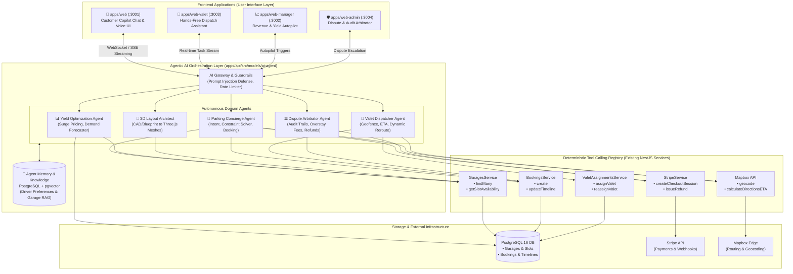

# Autospace Agentic AI Implementation Blueprint & Roadmap

## 1. Executive Summary

This document provides a comprehensive technical blueprint for integrating **Agentic AI** into the **Autospace** multi-tenant parking reservation and valet management platform.

Unlike traditional passive conversational chatbots that merely answer static questions, **Agentic AI systems** are autonomous software agents characterized by:
1. **Goal-Driven Reasoning**: Continuously observing environmental state, formulating plans, and executing actions to achieve high-level objectives.
2. **Deterministic Tool Use**: Interacting directly with the application ecosystem via GraphQL queries/mutations, Prisma ORM operations, Mapbox routing APIs, and Stripe payment gateways.
3. **Multi-Agent Collaboration**: Specialized domain agents communicating, negotiating, and delegating sub-tasks.
4. **Adaptive Recovery**: Autonomously detecting friction (e.g., slot full, traffic jam, payment decline) and replanning without human frustration.

---

## 2. System Architecture: Agentic AI Integration

The diagram below illustrates how an Agentic Orchestration Layer embeds into the existing NestJS backend and Next.js frontend applications:



---

## 3. The 5 Core Autonomous Agents

### 🤖 Agent 1: Autonomous Parking Concierge (Customer Web App)
* **Goal**: Enable drivers to discover, reserve, and pay for the optimal parking slot using natural language or voice, handling multi-variable constraints automatically.
* **Target UI**: An interactive slide-over copilot and voice assistant inside `apps/web` (:3001).
* **Sample Interaction**:
  > *"I'm driving a Ford F-150 and going to the basketball game at Madison Square Garden tonight from 7 to 11 PM. I need a tall-clearance spot with valet pickup under $35."*
* **Autonomous Execution Loop**:
  1. **Entity Extraction**: Location (`MSG`), time window (`19:00 - 23:00`), vehicle constraints (`tall-clearance / SUV`), budget (`< $35`), service preference (`valet`).
  2. **Tool Call `geocodeAddress('Madison Square Garden')`**: Converts location into latitude/longitude coordinates.
  3. **Tool Call `queryGaragesWithFilter(...)`**: Queries garages within 0.75 miles, filtering for slot heights accommodating an F-150.
  4. **Dynamic Recovery**: If nearest garage is $42 (over budget), the agent automatically widens search to 1.0 mile, finds a $30 option, calculates a 4-minute walking route, and proposes it.
  5. **Tool Call `createStripeCheckout(...)`**: Generates a pre-filled checkout link for instant confirmation.

---

### 🧤 Agent 2: Autonomous Valet Dispatch & Dynamic Re-Route Agent (Valet Operations)
* **Goal**: Autonomously orchestrate vehicle pickup, parking, and return handoffs without requiring manual dispatcher management.
* **Target UI**: Real-time push task stream in `apps/web-valet` (:3003).
* **Autonomous Execution Loop**:
  1. **Geofence Monitoring**: Monitors driver ETA via Mapbox. When a driver is 5 minutes away from the garage pickup zone, the agent triggers preparation.
  2. **Workload & Location Optimization**: Evaluates all currently clocked-in valets (status, current floor, active trips).
  3. **Assignment Dispatch**: Autonomously calls `valetAssignmentsService.create()` to assign the optimal valet.
  4. **Dynamic Rescheduling**: If Valet A encounters a delay (e.g. stalled vehicle on ramp 3), the agent autonomously detects the bottleneck, reassigns the pickup to Valet B, and updates the customer with an updated valet name and photo.

---

### 📈 Agent 3: Dynamic Pricing & Yield Optimization Agent (Manager Portal)
* **Goal**: Maximize garage revenue and occupancy yield by continuously adjusting slot pricing tiers based on real-time external demand.
* **Target UI**: "Yield Autopilot" toggle in `apps/web-manager` (:3002).
* **Autonomous Execution Loop**:
  1. **Environmental Perception**: Ingests weather forecasts (rain drives covered parking demand), municipal events, and local ticketed venues.
  2. **Occupancy Trend Analysis**: Observes that Saturday evening occupancy in Downtown garages consistently reaches 95% 3 hours before concert start times.
  3. **Price Formulation**: Calculates demand elasticity and increases spot prices from $12/hr to $24/hr in 15% progressive increments.
  4. **Safety Guardrails**: Operates strictly within user-configured minimum and maximum price boundaries set by the garage owner.
  5. **Automated Action**: Calls `garagesService.updateSlotPricing()` and pushes a summary report to the owner.

---

### ⚖️ Agent 4: Automated Overstay & Dispute Arbitrator (Admin Portal)
* **Goal**: Resolve reservation discrepancies, overstay billing, and cancellation dispute claims automatically.
* **Target UI**: Dispute Management Console in `apps/web-admin` (:3004).
* **Autonomous Execution Loop**:
  1. **Timeline Audit**: Compares booked departure timestamp with the physical valet vehicle scan-out timestamp recorded in `BookingTimeline`.
  2. **Evidence Synthesis**: Reconciles garage gate logs, customer claims, and payment records.
  3. **Action Execution**:
     - Under 15-minute grace period $\rightarrow$ Waive fee and notify customer.
     - Over 1-hour unauthorized overstay $\rightarrow$ Calculate prorated hourly fee + late surcharge, and call `stripeService.chargeCardOffSession()`.
     - Valid cancellation claim $\rightarrow$ Autonomously invoke `stripeService.issueRefund()`.

---

### 📐 Agent 5: Spatial 3D Parking Layout Architect (@autospace/3d & Three.js)
* **Goal**: Assist garage operators during onboarding by generating 3D parking lot layouts from raw dimensions or blueprints.
* **Target UI**: 3D Garage Studio in `apps/web-manager`.
* **Autonomous Execution Loop**:
  1. **Input Analysis**: Takes garage footprint dimensions (e.g. $60\text{m} \times 40\text{m}$, 3 levels, 1 ramp).
  2. **Space Optimization**: Calculates optimal lane widths, turning radii, and maximum stall density for compact, standard, and EV-charging slots.
  3. **3D Mesh Generation**: Emits structured Three.js coordinate matrices and Prisma `Slot` seed arrays directly into the database.

---

## 4. Deterministic Tool Calling Specifications

To integrate with an LLM agent framework (such as LangChain, LangGraph, or Vercel AI SDK), existing NestJS services are converted into typed tools:

### Tool Definition 1: `search_available_garages`
```typescript
import { tool } from '@langchain/core/tools'
import { z } from 'zod'

export const searchAvailableGaragesTool = (garagesService: any) =>
  tool(
    async ({ latitude, longitude, radiusKm, startTime, endTime }) => {
      const results = await garagesService.findNearbyWithAvailability({
        lat: latitude,
        lng: longitude,
        radius: radiusKm,
        from: new Date(startTime),
        to: new Date(endTime),
      })
      return JSON.stringify(results)
    },
    {
      name: 'search_available_garages',
      description: 'Finds parking garages with available slots near coordinates for a specific time range',
      schema: z.object({
        latitude: z.number().describe('Latitude of the search center'),
        longitude: z.number().describe('Longitude of the search center'),
        radiusKm: z.number().default(1.5).describe('Search radius in kilometers'),
        startTime: z.string().describe('ISO 8601 start time'),
        endTime: z.string().describe('ISO 8601 end time'),
      }),
    }
  )
```

### Tool Definition 2: `create_stripe_booking_session`
```typescript
export const createStripeBookingSessionTool = (stripeService: any) =>
  tool(
    async ({ garageId, slotId, startTime, endTime, customerUid }) => {
      const session = await stripeService.createStripeSession({
        bookingData: {
          garageId,
          slotId,
          startTime: new Date(startTime),
          endTime: new Date(endTime),
          customerId: customerUid,
        },
      })
      return JSON.stringify({ checkoutUrl: session.url, sessionId: session.sessionId })
    },
    {
      name: 'create_stripe_booking_session',
      description: 'Generates a secure Stripe checkout session URL for parking spot reservation',
      schema: z.object({
        garageId: z.number().describe('Target garage ID'),
        slotId: z.number().describe('Target slot ID'),
        startTime: z.string().describe('Start timestamp ISO'),
        endTime: z.string().describe('End timestamp ISO'),
        customerUid: z.string().describe('Customer user ID'),
      }),
    }
  )
```

### Tool Definition 3: `dispatch_valet_pickup`
```typescript
export const dispatchValetPickupTool = (valetAssignmentsService: any) =>
  tool(
    async ({ bookingId, valetId, pickupLocation }) => {
      const assignment = await valetAssignmentsService.create({
        bookingId,
        pickupValetId: valetId,
        pickupLat: pickupLocation.lat,
        pickupLng: pickupLocation.lng,
      })
      return JSON.stringify({ assignmentId: assignment.id, status: 'DISPATCHED' })
    },
    {
      name: 'dispatch_valet_pickup',
      description: 'Assigns an active valet driver to a customer vehicle pickup request',
      schema: z.object({
        bookingId: z.number().describe('Booking ID'),
        valetId: z.string().describe('Valet user UID'),
        pickupLocation: z.object({
          lat: z.number(),
          lng: z.number(),
        }),
      }),
    }
  )
```

---

## 5. Memory, State & Knowledge Architecture

To make agents remember driver habits and understand garage idiosyncrasies:

1. **Short-Term Conversational Memory**:
   - Redis or in-memory sliding window session store tracking active chat turns and reservation drafts.
2. **Long-Term User Persona Memory**:
   - Stored in PostgreSQL: vehicle dimensions (make/model/height), preferred payment methods, average parking duration, and sensitivity to walking distances.
3. **Semantic Knowledge Base (RAG with pgvector)**:
   - Enable `pgvector` in PostgreSQL 16.
   - Embed garage amenities, height clearances, operating hours, and cancellation terms as vector embeddings to support semantic queries like *"garages with Tesla superchargers that fit a lifted pickup"*.

---

## 6. Safety, Guardrails & Human-in-the-Loop Controls

| Boundary | Mechanism | Description |
|---|---|---|
| **Financial Thresholds** | Confirmation Gate | Agents cannot charge cards off-session for disputes $> \$50$ without explicit manager or customer confirmation. |
| **Pricing Volatility Caps** | Rate of Change Limit | The Yield Optimization Agent is restricted to price adjustments within $-30\%$ to $+100\%$ of base rates, at most once per 60 minutes. |
| **PII & Data Masking** | In-flight Sanitizer | Phone numbers, full card digits, and driver license IDs are masked before prompt serialization. |
| **Prompt Injection Defense** | Input Sanitization | Driver inputs are validated through classifier guardrails to prevent system prompt override attacks. |

---

## 7. Phased Implementation Roadmap

```
2026 Q4 (Phase 1)          2027 Q1 (Phase 2)            2027 Q2 (Phase 3)
┌───────────────────────┐  ┌─────────────────────────┐  ┌─────────────────────────┐
│ Conversational Agent  │  │ Dynamic Pricing Agent   │  │ Autonomous Dispatcher   │
│ • apps/web chat UI    │  │ • Event & demand feeds  │  │ • Real-time valet GPS   │
│ • LangChain in NestJS │  │ • apps/web-manager auto │  │ • Automatic reassignment│
│ • Search & Book tools │  │ • Guardrail price caps  │  │ • Overstay arbitration  │
└───────────────────────┘  └─────────────────────────┘  └─────────────────────────┘
```

### Phase 1: Customer Booking Concierge (Weeks 1-4)
- Install `@langchain/core`, `@langchain/openai` (or `@google/genai`) and `zod` in `apps/api`.
- Create `apps/api/src/models/ai-agent` module.
- Wrap `GaragesService` and `BookingsService` into typed tools.
- Add an interactive chat interface to `apps/web` with streaming responses.

### Phase 2: Dynamic Yield Autopilot (Weeks 5-8)
- Implement cron-driven demand analytics agent in NestJS.
- Connect local ticket and event APIs.
- Add revenue analytics dashboard in `apps/web-manager`.

### Phase 3: Valet Dispatch & Incident Resolution (Weeks 9-12)
- Integrate live Mapbox GPS tracking with WebSocket notifications.
- Enable autonomous valet reassignment logic.
- Deploy automated dispute & overstay arbitrator in `apps/web-admin`.
