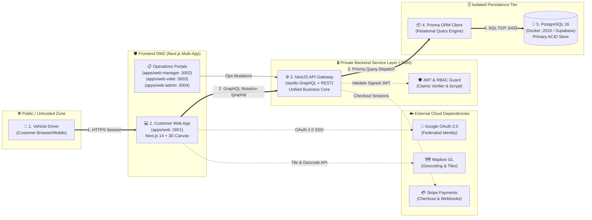

# Autospace Core Runtime Architecture

## 1. Executive Architecture Summary

This document outlines the **10 core runtime components**, the **single primary execution path**, **external dependencies**, and **trust boundaries** for the **Autospace** multi-tenant parking reservation and valet management platform.

To avoid visual edge tangling and cognitive overload, secondary interactions and implementation nuances are encapsulated within structured architectural cards rather than redundant diagram edges.

---

## 2. High-Level Core Runtime Architecture Diagram



---

## 3. The 10 Core Components

| # | Component ID | Type | Runtime Location | Primary Responsibility |
|---|---|---|---|---|
| 1 | **Vehicle Driver** (`users_driver`) | External Actor | Browser / Mobile | End-user discovering garages, selecting parking slots, and reserving parking. |
| 2 | **Customer Web App** (`web_customer`) | Frontend | `apps/web` (Port 3001) | Next.js 14 web app featuring Mapbox location search and Three.js 3D parking lot picker. |
| 3 | **Operations Portals** (`web_operations`) | Frontend | `apps/web-manager` (3002)<br>`apps/web-valet` (3003)<br>`apps/web-admin` (3004) | Dedicated operational portals for garage owners, valet drivers, and super-admins. |
| 4 | **NestJS API Gateway** (`api_gateway`) | Backend | `apps/api` (Port 3000) | Single entry point hosting Apollo GraphQL (`/graphql`) and Swagger REST controllers. |
| 5 | **JWT & RBAC Guard** (`auth_guard`) | Security | `apps/api/src/common/auth` | Enforces authentication and role claims (`Customer`, `Manager`, `Valet`, `Admin`). |
| 6 | **Prisma ORM Client** (`prisma_orm`) | Backend | `apps/api/prisma` | Type-safe data access layer translating domain operations into SQL queries. |
| 7 | **PostgreSQL 16 Database** (`postgres_db`) | Database | Docker Port 2010 (mapped to 5432) | ACID transactional store holding garages, slots, bookings, users, and audit logs. |
| 8 | **Google OAuth 2.0** (`google_auth`) | Security (External) | Google Identity Cloud | Federated SSO authentication provider integrated via NextAuth.js. |
| 9 | **Mapbox GL Cloud** (`mapbox_api`) | Cloud (External) | Mapbox Public API | Cloud geocoding, vector map tile rendering, and vehicle routing. |
| 10 | **Stripe Payments** (`stripe_api`) | Cloud (External) | Stripe API | Offloaded PCI-compliant checkout sessions and payment webhook confirmations. |

---

## 4. Single Primary Path: Driver Parking Reservation

The architecture establishes **one clear primary request flow** across the system:

```
[Vehicle Driver] 
       │ 1. HTTPS Session
       ▼
[Customer Web App (:3001)] 
       │ 2. GraphQL /graphql (mutation CreateBooking)
       ▼
[NestJS API Gateway (:3000)] 
       │ 3. ORM Query Dispatch (BookingsService -> prisma.booking.create)
       ▼
[Prisma ORM Client] 
       │ 4. SQL Protocol (INSERT INTO bookings, booking_timelines)
       ▼
[PostgreSQL 16 (:2010 -> :5432)]
```

1. **Step 1 — Initiation**: The Driver navigates to `http://localhost:3001` over HTTPS, picks a date/time and selects an available slot.
2. **Step 2 — Ingestion**: The Customer Web App sends an Apollo GraphQL request (`mutation CreateBooking($input)`) to `http://localhost:3000/graphql` containing the reservation payload and JWT bearer token.
3. **Step 3 — Resolution**: The NestJS GraphQL resolver validates the input and delegates execution to `BookingsService`, which invokes `prisma.booking.create()`.
4. **Step 4 — Persistence**: Prisma serializes the transaction into SQL statements over a secure TCP connection to PostgreSQL, persisting the booking and generating audit records.

---

## 5. Trust Boundaries & Security Isolations

```
┌────────────────────────────────────────────────────────────────────────┐
│  ZONE 1: Public / Untrusted Zone                                       │
│  - Actors: Vehicle Drivers, Public Web Clients                         │
│  - Threat Model: Untrusted traffic, CSRF, malformed HTTP payloads      │
└────────────────────────────────────────────────────────────────────────┘
                                 │
                            HTTPS / TLS
                                 ▼
┌────────────────────────────────────────────────────────────────────────┐
│  ZONE 2: Frontend DMZ (Next.js Multi-App Cluster)                      │
│  - Apps: Customer Web (:3001), Manager (:3002), Valet (:3003), Admin   │
│  - Protection: Environment variables masked, NextAuth JWT sessioning   │
│  - Threat Model: Cross-site scripting (XSS), token leakage             │
└────────────────────────────────────────────────────────────────────────┘
                                 │
                   Internal GraphQL (JWT Bearer Auth)
                                 ▼
┌────────────────────────────────────────────────────────────────────────┐
│  ZONE 3: Private Backend Service Layer                                 │
│  - Service: NestJS Core API Gateway (:3000)                            │
│  - Protection: JwtGuard role enforcement, ClassValidator DTO filters   │
│  - Threat Model: Privilege escalation, injection attacks               │
└────────────────────────────────────────────────────────────────────────┘
                                 │
                         Internal Network / VPC
                                 ▼
┌────────────────────────────────────────────────────────────────────────┐
│  ZONE 4: Isolated Persistence Tier                                     │
│  - Components: Prisma Client, PostgreSQL 16 DB Container               │
│  - Protection: Database port bound locally/privately, parameterized SQL│
│  - Threat Model: Data corruption, unauthorized direct SQL reads        │
└────────────────────────────────────────────────────────────────────────┘
```

---

## 6. Architectural Supporting Details (Cards)

> [!NOTE]
> ### 🟢 Card 1: Primary Execution Path Nuances
> - **Idempotency**: Booking mutations enforce transactional slot locking to prevent concurrent double-booking of the same parking space.
> - **Optimistic UI**: The Next.js frontend updates slot availability status optimistically in the Apollo cache before receiving server confirmation.
> - **Telemetry**: GraphQL execution duration and database query times are logged in NestJS interceptors for observability.

> [!IMPORTANT]
> ### 🔴 Card 2: Security & Trust Boundary Enforcement
> - **JWT Verification**: The backend verifies token signatures using `JWT_SECRET` (`@nestjs/jwt`) on every guarded GraphQL resolver.
> - **Role Separation**: 
>   - `Customer`: Restricted to personal bookings, vehicles, and reviews.
>   - `Manager`: Scoped strictly to company-owned garages and slots.
>   - `Valet`: Scoped to assigned pickup and return vehicle trips.
>   - `Admin`: Unrestricted platform governance and garage verifications.
> - **Password Security**: Passwords for local credentials never enter the database in plaintext; they are hashed via `bcryptjs` with salt rounds.

> [!TIP]
> ### 🟣 Card 3: External Dependencies & Offloading
> - **Stripe Checkout**: Rather than handling raw credit card data on the server (requiring PCI-DSS compliance), the API offloads card collection to Stripe Checkout sessions.
> - **Stripe Callback**: Payment completion triggers `GET /stripe/success?session_id=...`, which verifies the session metadata and transitions booking status to `CONFIRMED`.
> - **Mapbox Integration**: Maps vector tiles and turn-by-turn driving directions are loaded client-side via `NEXT_PUBLIC_MAPBOX_TOKEN` directly from Mapbox edge CDN.
> - **Google OAuth 2.0**: Handled via OpenID Connect in NextAuth; returns Google `sub` ID mapped to internal `User` and `AuthProvider` records.

> [!NOTE]
> ### 🟡 Card 4: Operations & Specialized Subsystems
> - **3D Garage Spatial Engine (`@autospace/3d`)**: Built with Three.js and React Three Fiber to render interactive 3D structures with floor-by-floor slot inspection.
> - **Valet Dispatch Workflow**: When a booking with valet service is confirmed, a `ValetAssignment` is created, sending live pickup cards to `apps/web-valet` (:3003).
> - **REST / Swagger Dual Gateway**: While the core app runs on GraphQL, REST endpoints (`/`) are exposed via Swagger for health checks and third-party webhooks.

---

## 7. Artifacts & Generated Deliverables

- **Standalone Core Architecture (Archify Vector Diagram)**: [runtime-core.html](file:///d:/desktop/autospace-workshop/architecture/runtime-core.html)
- **Archify Candidate Spec**: [runtime-core.candidate.json](file:///d:/desktop/autospace-workshop/architecture/runtime-core.candidate.json)
- **Interactive Live Dashboard**: [index.html](file:///d:/desktop/autospace-workshop/index.html) (Live on `http://127.0.0.1:5500`)


npx skills add tt-a1i/archify -g
hey install npx skills add tt-a1i/archify -g , analyze this trepo, then use a high-level runtime architecture diagram
show 8 t0 12 core components , one primary oath , external depencies and trust biundaries. put supporting details in card instead of adding more edges and creaye md file 