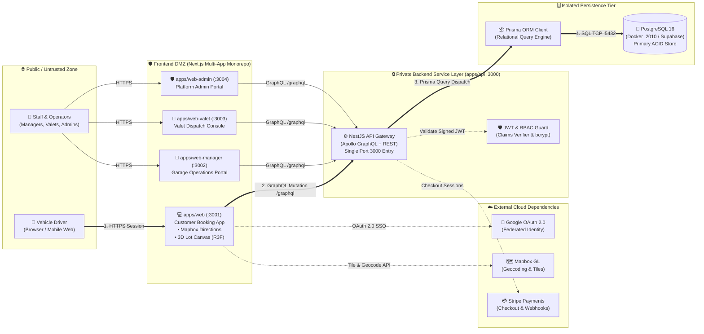
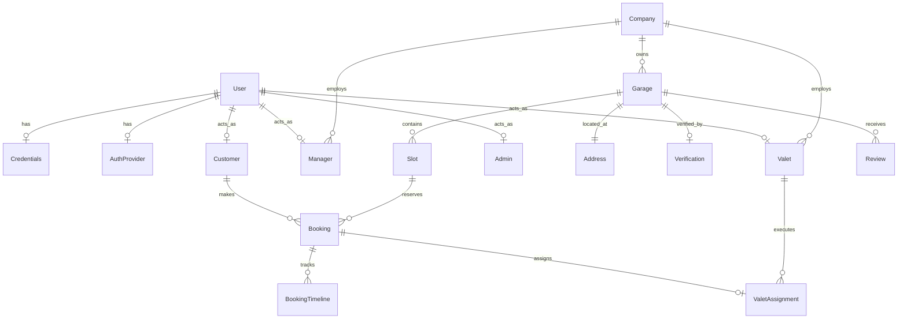

# System Architecture Document: Autospace Platform

---

## 1. System Overview & Technology Stack

The **Autospace Platform** is architected as an enterprise-grade TypeScript monorepo orchestrated with **Nx** and **Yarn Workspaces**. It couples reactive, server-rendered **Next.js 14** web portals with a centralized, modular **NestJS 9** backend communicating via **Apollo GraphQL** and **OpenAPI REST**.

### Core Technology Stack

```
┌────────────────────────────────────────────────────────────────────────┐
│                              CLIENT TIER                               │
│  • Next.js 14 (App Router & Pages)     • React 18                      │
│  • TailwindCSS 3.4                     • Apollo Client 3               │
│  • Mapbox GL JS 3.3                    • Three.js / React Three Fiber  │
├────────────────────────────────────────────────────────────────────────┤
│                              BACKEND TIER                              │
│  • NestJS 9 Modular Architecture       • Apollo Server (Code-First)    │
│  • Swagger / OpenAPI                   • JWT Auth Guard + bcryptjs     │
│  • Stripe Node SDK                     • Class-Validator & Transformer │
├────────────────────────────────────────────────────────────────────────┤
│                           DATA & PERSISTENCE                           │
│  • PostgreSQL 16 (Docker / Supabase)   • Prisma ORM 5.11               │
│  • nestjs-prisma-codegen               • ACID Transactional Engine     │
└────────────────────────────────────────────────────────────────────────┘
```

---

## 2. Monorepo Structure & Application Roles

```
autospace-workshop/
├── apps/
│   ├── api/             # [Port 3000] NestJS Gateway (GraphQL /graphql, Swagger REST /)
│   ├── web/             # [Port 3001] Customer Booking Portal (NextAuth, Mapbox, 3D Canvas)
│   ├── web-manager/     # [Port 3002] Garage & Operator Management Console
│   ├── web-valet/       # [Port 3003] Valet Attendant Intake & Dispatch Console
│   └── web-admin/       # [Port 3004] Super-Admin Governance & Verification Console
├── libs/
│   ├── 3d/              # @autospace/3d: Three.js & React Three Fiber slot spatial rendering
│   ├── network/         # @autospace/network: Apollo Client, GraphQL Codegen, NextAuth config
│   ├── ui/              # @autospace/ui: Shared React Tailwind design system, Mapbox components
│   ├── forms/           # @autospace/forms: Shared React Hook Form & validation schemas
│   └── util/            # @autospace/util: Common date, currency, and calculation helpers
└── docker-compose.yml   # PostgreSQL 16 Alpine container (Local port 2010 -> 5432)
```

---

## 3. High-Level Runtime Architecture



---

## 4. Single Primary Path: Driver Parking Reservation

To keep the system straightforward and understandable, the core transactional workflow is represented as a single, deterministic linear path:

```
[Vehicle Driver]
       │ 1. HTTPS Session (:3001)
       ▼
[Customer Web App]
       │ 2. GraphQL /graphql (mutation CreateBooking)
       ▼
[NestJS API Gateway (:3000)]
       │ 3. ORM Query Dispatch (BookingsService -> prisma.booking.create)
       ▼
[Prisma ORM Client]
       │ 4. SQL Protocol (INSERT INTO bookings, booking_timelines)
       ▼
[PostgreSQL 16 (:2010 -> :5432)]
```

---

## 5. Relational Data Model (Prisma Schema)

The PostgreSQL database is organized around 14 relational entities:



### Core Entity Relationships:
1. **User Identity & Roles**: The `User` model acts as the root identity. It links 1:1 to either `Credentials` (email/password) or `AuthProvider` (Google OAuth), and optionally extends into specialized role profiles: `Customer`, `Manager`, `Valet`, or `Admin`.
2. **Organization & Location**: A `Company` owns multiple `Garages`. Each `Garage` has an `Address` storing exact floating-point `lat` and `lng` coordinates for Mapbox spatial radius queries.
3. **Inventory & Reservation**: A `Garage` holds multiple `Slots` (categorized by type: Compact, Regular, EV, Disability). A `Booking` binds a `Customer` to a `Slot` across a temporal range (`startTime` to `endTime`).
4. **Lifecycle & Valet**: Each booking maintains a sequential `BookingTimeline` (Created $\rightarrow$ Paid $\rightarrow$ Checked In $\rightarrow$ Completed). Bookings opting for valet service generate a `ValetAssignment` linked to designated pickup/return valets.

---

## 6. Security & Trust Boundaries

| Zone | Assets | Threat Model | Security Enforcement |
|---|---|---|---|
| **Zone 1: Public Internet** | End-user browsers, native webviews | Man-in-the-middle, CSRF, malformed inputs | Enforced HTTPS/TLS 1.3, Strict CORS policy in `main.ts` |
| **Zone 2: Frontend DMZ** | Next.js Node.js servers (`:3001` - `:3004`) | XSS, session hijacking, secret leakage | `NEXTAUTH_SECRET` session signing, env variable scoping, public keys only |
| **Zone 3: Private Backend Layer** | NestJS Core API (`:3000`) | Unauthorized access, privilege escalation | `JwtGuard` role claim validation, `class-validator` DTO sanitization |
| **Zone 4: Persistence Tier** | PostgreSQL container / Supabase | SQL injection, unauthorized table reads | Parameterized Prisma queries, local network port isolation |

---

## 7. Deployment & Infrastructure Architecture

* **Local Development**:
  - PostgreSQL running via `docker-compose.yml` on port `2010` mapped to container port `5432`.
  - NestJS API running via `yarn dev` on port `3000`.
  - Next.js frontends running concurrently on ports `3001`, `3002`, `3003`, and `3004`.
* **Production Deployment**:
  - Frontends deployed to Vercel or containerized on AWS ECS / Render.
  - Backend API hosted on Node.js container cluster behind an Application Load Balancer.
  - Database provisioned on managed PostgreSQL (AWS RDS or Supabase) with automated daily backups.
